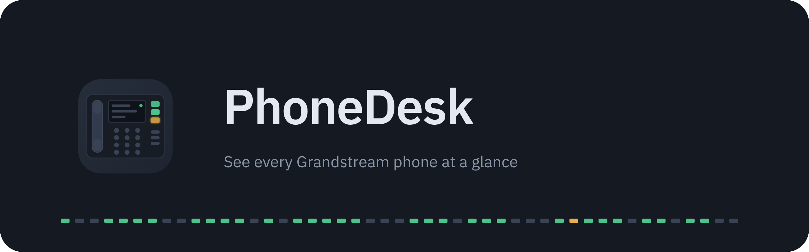
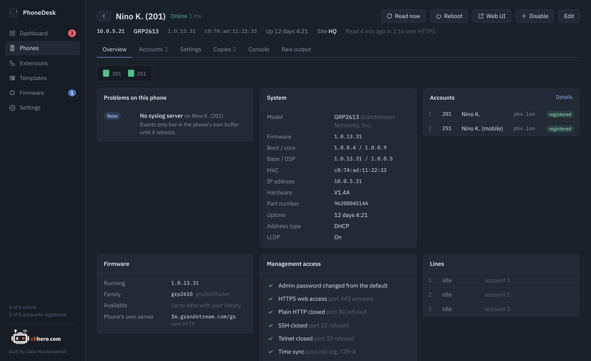

<p align="center">
  
</p>

<p align="center">
  A desktop app for Grandstream IP phones. It logs in to each phone's web interface, reads it, and shows you which phones are up, which accounts are registered and what's set wrong.
</p>

<p align="center">
  
  
  
  
  
</p>

<p align="center">
  <a href="https://jaba0x.github.io/PhoneDesk/"><b>Website</b></a> ·
  <a href="https://jaba0x.github.io/PhoneDesk/docs/"><b>Documentation</b></a> ·
  <a href="https://github.com/jaba0x/PhoneDesk/releases/latest"><b>Download</b></a> ·
  <a href="https://github.com/jaba0x/PhoneDesk/discussions"><b>Discussions</b></a>
</p>

<p align="center">
  
</p>

## Why

A few dozen desk phones are too few for a management platform and too many to click through one web page at a time. Still, every morning the same questions come up: is every phone online, did an account drop its registration, does one of them still have the factory password, and which ones are a firmware version behind. PhoneDesk answers them on one screen. It talks to each phone the way you would, through its own web interface, and keeps everything on your computer.

It's a sibling of [SwitchDesk](https://github.com/jaba0x/SwitchDesk), which does the same for Aruba switches.

## Features

### Dashboard
Online and offline counts, how many SIP accounts are registered, and a problem list sorted by severity. Every phone is drawn with one LED per account: green is registered, red is not, grey is an account that's switched off, blue blinks while a line is in a call.

### Problems it catches

| Area | Checks |
|---|---|
| Reachability | Phone offline, web login failing, reading the phone failing |
| Accounts | Account not registered, an account with a user ID but no SIP server, a phone with no usable account at all, the same extension registered from two phones |
| Security | Factory admin password still accepted, web access over plain HTTP, Telnet open, SSH open |
| Settings | No NTP server, no syslog server, DHCP option 66 allowed to override the provisioning server |
| Firmware | A newer image for the phone's family sitting in your library |

Every check can be switched off in Settings. An active account with nothing in it, the factory state of account 2 on many GXP phones, is never flagged.

### Every phone, in detail

<p align="center">
  
</p>

Model, firmware (program, boot, core, base and DSP), MAC, uptime, network settings, a management access checklist, every SIP account with its registration state, and the live state of each line key. The Settings tab shows the phone's values grouped by topic with their names, so `P30` reads as "NTP server". The Raw output tab keeps every answer the phone gave, exactly as it came.

A copy of the phone's settings is saved whenever they change. Any two copies can be compared side by side, and a copy can be written back to the phone.

The console reads any P-value or status key straight from the phone, writes values, and dials a number on a chosen account.

### Templates: one list of settings, many phones
A template is a list of `P-value = value` lines. Pick settings by name from a list that knows the common ones (accounts, web access passwords, network, time, logging, provisioning, firmware upgrade, calls) or type any P-value. Apply a template to any number of phones: PhoneDesk reads each phone first and shows you exactly which values would change where, and only then writes them. Tick a box to reboot the phones afterwards, which network and some provisioning changes need.

The same template can be exported as `cfg<mac>.xml` files, one per phone, for a provisioning server you already run.

### Extensions
Every SIP account across all phones in one table: extension, display name, which phone it's on, and whether it's registered. Search it to find out which desk 214 sits on.

### Firmware updates
Add `.bin` images to the library, or paste a download link from Grandstream's firmware page: a `Release_….zip` or a bare `…fw.bin` both work, and the version is read from the file name. Images are matched to phones by firmware family, so a GRP2613 is offered `grp2610fw.bin` and a GXP2170 `gxp2130fw.bin`. Phones with something newer in the library are listed on the Firmware page; tick them and update.

Grandstream phones fetch firmware themselves, so for an update PhoneDesk points the phone at an image, reboots it, waits for it to download and install, and checks that it came back on the new version. Then the phone's previous upgrade settings are put back. Phones are updated one after another, so a bad image can't take a whole office down at once.

By default the image is served from your computer over HTTP (port 6970, changeable), which means the phone has to be able to reach your computer. When it can't, over zero trust access or a one-way VPN, pick the SSH relay instead: PhoneDesk copies the image over SSH to a server the phones can reach (a FreePBX box with its TFTP root, say) and points the phones at that. Or point them at `firmware.grandstream.com` or a server you fill yourself.

### Phone list
Search by name, extension, address, site, model, firmware or MAC, or by state: `offline`, `disabled`, `unregistered`, `problem`, `update`. Press `/` to jump to the search box. Tick phones to read, reboot, apply a template, update, disable, enable or delete them together, or use the small buttons at the end of each row. A disabled phone keeps its last data but isn't checked, read or alerted on until you enable it again.

### Finding phones
Add phones by address, paste a list (`name, address` pairs and ranges like `10.0.5.20-10.0.5.60` work), or scan a network. The scan knocks on each address's web port and keeps the ones that answer like a Grandstream phone; nothing is logged in to. Pick the ones you want and they're added with the credentials you choose.

## Supported phones

| Family | Models | Notes |
|---|---|---|
| GRP26xx | GRP2601, 2602, 2603, 2604, 2612, 2613, 2614, 2615, 2616, 2624, 2634, 2636, 2650, 2670 | |
| GXP21xx | GXP2130, 2135, 2140, 2160, 2170 | |
| GXP16xx / GXP17xx | GXP1610, 1615, 1620, 1625, 1628, 1630, 1760, 1780, 1782 | |
| Others | GXV33xx/34xx video phones, WP8xx and DP7xx cordless, HT8xx adapters | Same web API. Line status may be missing on some. |

All a phone needs is its web interface switched on (HTTPS or HTTP) and the admin password. Registration state comes from the phone's line status, which needs **Action URI support** turned on in the phone's web UI; without it the accounts show as "unknown" and everything else still works.

## Install

Download the latest build from **[Releases](https://github.com/jaba0x/PhoneDesk/releases/latest)**.

### macOS

Get `PhoneDesk-…-macos-universal.zip` (runs on Apple Silicon and Intel), unzip it and drag **PhoneDesk** into Applications. The app isn't notarized by Apple, so the first time right-click it and choose **Open**, or run:

```sh
xattr -dr com.apple.quarantine /Applications/PhoneDesk.app
```

### Windows

Get `PhoneDesk-…-windows-x64.zip`, unzip it and run `PhoneDesk.exe`. If SmartScreen warns about an unknown publisher, choose **More info → Run anyway**. WebView2 is already part of Windows 10 and 11.

### Build it yourself

With Go 1.23+ installed (on a Mac also the Xcode command line tools):

```sh
git clone https://github.com/jaba0x/PhoneDesk.git
cd PhoneDesk
./scripts/build-mac.sh          # macOS: builds, installs to /Applications and opens it
.\scripts\build-windows.ps1     # Windows: builds build\bin\PhoneDesk.exe
```

### Staying up to date

PhoneDesk checks GitHub for a newer release when it starts and every few hours after. When one is out, a yellow bar at the top of the window links to the download. **Settings → Check for updates** does the same on demand.

### Releases

The **build** workflow publishes a release with both downloads attached. Push a tag like `v0.2.0`, or run the workflow from the Actions tab and enter a version.

## Getting started

1. **Add a phone** with its address and admin login. **Test connection** shows the model and firmware before you save.
2. Or **Scan** a network and add what it finds, or **Add many** from a list.
3. The first read starts right away. After that, reachability is checked every 30 seconds and each phone is re-read every 15 minutes, four at a time. All three are adjustable in Settings.

## Your data

Everything stays on your computer, in one folder.

| OS | Default folder |
|---|---|
| macOS | `~/Library/Application Support/PhoneDesk` |
| Windows | `%AppData%\PhoneDesk` |

- `inventory.json` holds phones, credentials, templates and settings. Passwords are encrypted with AES-GCM using a key in `secret.key`, readable only by your user.
- `snapshots/` keeps the last reading of each phone, so the app opens with data.
- `backups/` keeps a copy of a phone's settings each time they change.
- `firmware/` is the image library.

**Choosing another folder.** Settings → Data → Change lets you move the data to another disk or a synced drive, copy it there, or open a folder that already has PhoneDesk data. The key moves with the folder.

**Moving to another computer.** Settings → Data → Export writes a single `.pdbak` file. Passwords inside are re-encrypted with a passphrase you pick (Argon2id + AES-GCM), so the file is safe to carry around. On the other computer, Import either adds the file's phones to the ones already there or replaces everything with the file's contents.

Phones ship with a self-signed certificate, so PhoneDesk doesn't verify it over HTTPS. Plain HTTP works too, and is flagged on the dashboard because the admin password then travels in clear text.

## Documentation

The full guide is at **[jaba0x.github.io/PhoneDesk/docs](https://jaba0x.github.io/PhoneDesk/docs/)**: install, first steps, every screen, templates and provisioning files, firmware updates, moving your data, and troubleshooting. It's built with MkDocs from the `docs/` folder. The landing page at [jaba0x.github.io/PhoneDesk](https://jaba0x.github.io/PhoneDesk/) is plain HTML in `web/`. Both are published on every push.

## Development

```sh
go test ./internal/...
wails dev
```

The UI is plain HTML, CSS and JavaScript in `frontend/dist` with no build step. To work on it in a normal browser with sample data, open `frontend/dev/preview.html`.

```
internal/grandstream  the phone's web API (login, values, line status, reboot), P-value names, templates, cfg.xml
internal/core         polling, problem rules, templates applied to phones, network scan, firmware updates
internal/store        inventory, encrypted credentials, snapshots, settings copies, export and import
internal/firmware     image library, version matching, the HTTP server phones download from
internal/relay        copies images over SSH to a server the phones can reach
```

Phones differ in which status keys they answer. If one of yours shows blanks, the **Raw output** tab has exactly what it sent back, and that's what's needed to fix it.

## Author

<a href="https://clihero.com">
  <picture>
    <source media="(prefers-color-scheme: dark)" srcset="docs/clihero-logo-white.png">
    
  </picture>
</a>

Built by **Jaba Macharashvili**. More of my infra, homelab and hardware projects are on [clihero.com](https://clihero.com).

PhoneDesk is not affiliated with or endorsed by Grandstream Networks. Grandstream, GRP, GXP and GXV are trademarks of Grandstream Networks, Inc.

## Credits

Built with [Wails](https://wails.io). Fonts are [IBM Plex](https://github.com/IBM/plex), under the SIL Open Font License.
