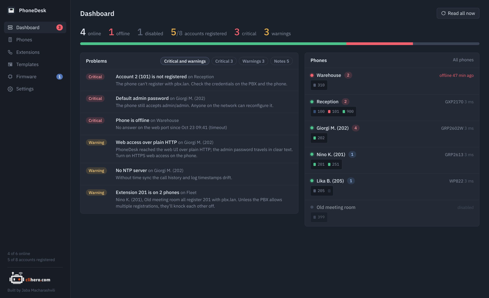

# Dashboard and problems

{ .shot }

The top line counts phones online, offline and disabled, accounts registered out of active accounts, and problems by severity. Click a count to go to the phone list.

## Problems

Every phone is checked against the same rules each time it's read, and the results land here sorted by severity. Click a problem to open the phone. The chips above the list filter it: by default critical problems and warnings are shown; **Notes** are the informational ones.

| Severity | Check | What it means |
|---|---|---|
| Critical | Phone is offline | The web port didn't answer. Shown with the time it went down. |
| Critical | Web login failed | The credentials were refused. Fix them under Edit, then read again. |
| Critical | Account N is not registered | The line for this account reports "failed". Check the credentials on the PBX and on the phone. |
| Critical | Default admin password | The phone still accepts `admin` / `admin`. Anyone on the network can reconfigure it. |
| Critical | Telnet is open | TCP 23 answers. |
| Warning | Reading the phone failed | The phone is up but the read didn't finish. The message has the reason. |
| Warning | Account N has no SIP server | The account is active and has a user ID, but nowhere to register. An active account with nothing in it at all (the factory state of account 2 on many GXP phones) isn't flagged. |
| Warning | No usable SIP account | No active account has a user ID or a server, so the phone can't make or receive calls. |
| Warning | Web access over plain HTTP | PhoneDesk reached the phone over HTTP, so the admin password travels in clear text. If HTTPS answers too, set the phone to HTTPS in Edit. |
| Warning | No NTP server | Call history and log timestamps drift; TLS registrations can fail. |
| Warning | Extension N is on two phones | Two phones register the same extension with the same server. Unless the PBX allows multiple registrations, they knock each other off. |
| Note | SSH is open | Fine if you use it. |
| Note | No syslog server | Events only live in the phone's own buffer until it reboots. |
| Note | DHCP option 66/43 may override the servers | Any DHCP server on the phone's network can point it elsewhere for provisioning. Off by default. |
| Note | Firmware N is in your library | A newer image for this phone's family is available on the Firmware page. |
| Note | Data is more than 6 hours old | The phone hasn't been read in a while. |

Every check can be switched off in [Settings](settings.md); option 66 starts off. The Telnet and SSH checks come from knocking on the ports directly, so they reflect what the phone actually answers, whatever its settings say.

## Phones

The right-hand panel draws each phone with one LED per account:

- green: registered
- red: not registered
- grey: the account is switched off
- dim: registration unknown (Action URI support is off on the phone)
- blue, blinking: a line on this account is in a call

Offline phones come first, then phones sorted by their worst problem; disabled phones go last. Click a phone to open it.

**Read all now** queues a fresh read of every online phone.
