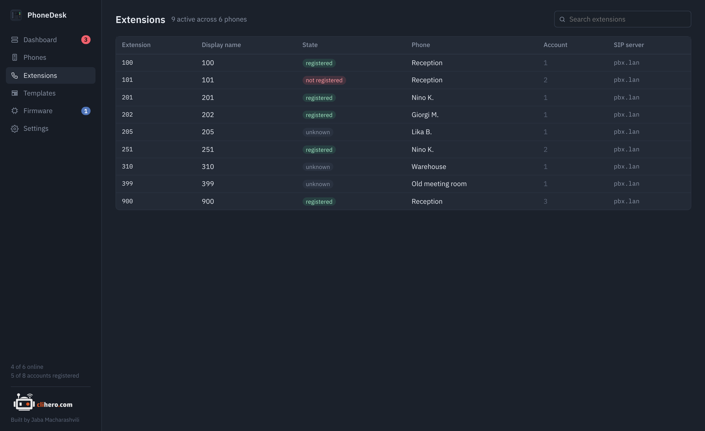

# Extensions

{ .shot }

Every SIP account from every phone in one table: extension (the SIP user ID), display name, registration state, which phone it's on, the account slot and the SIP server. The header counts active accounts and phones.

Search matches the extension, display name, server and phone name. Click a row to open that phone's Accounts tab.

An extension that's active on more than one phone with the same server gets a `×2` marker, and the dashboard raises a warning for it. Unless your PBX allows multiple registrations per extension, the phones will keep knocking each other off.

Accounts appear here after a phone has been read at least once. Registration state needs Action URI support turned on on the phone; see [Troubleshooting](troubleshooting.md).
