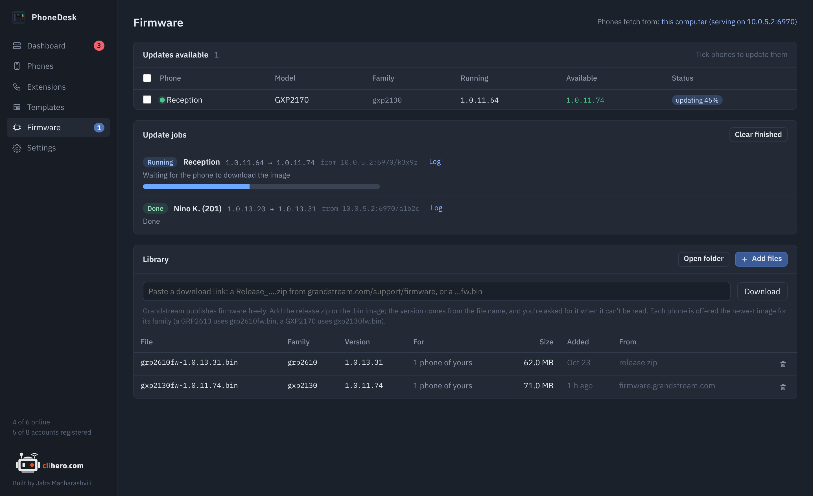
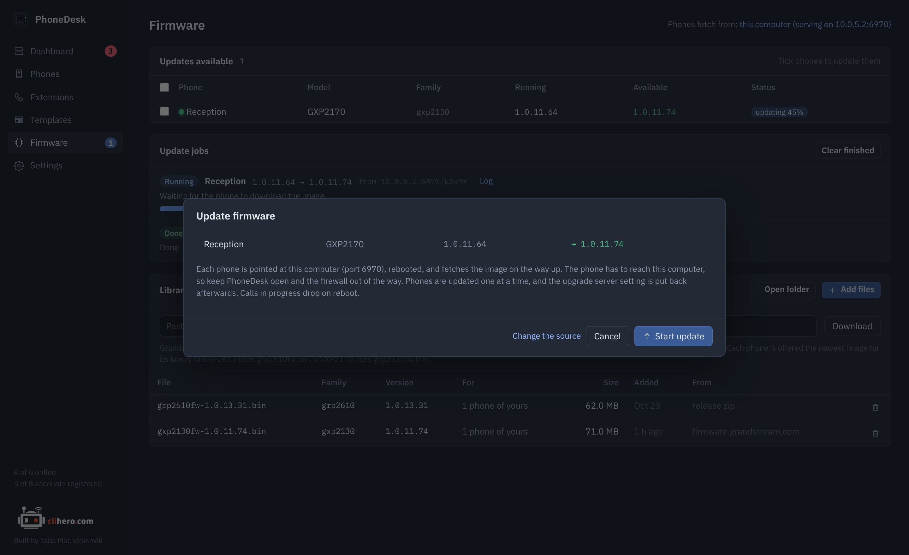

# Firmware updates

{ .shot }

## The library

The library is a folder of firmware images, kept in your data folder. Fill it two ways:

- **Add files**: pick `.bin` images you downloaded.
- **Download**: paste a link from [Grandstream's firmware page](https://www.grandstream.com/support/firmware). A `Release_….zip` is unpacked and the image taken out; a bare `…fw.bin` link is saved as is.

The version is read from the file name (`grp2610fw-1.0.13.31.bin`, `Release_GRP261x_1.0.13.31.zip`). When it can't be read, you're asked for it. Images are matched to phones by firmware family, which is what the phone itself downloads: a GRP2613 fetches `grp2610fw.bin`, a GXP2170 fetches `gxp2130fw.bin`, a GXP1628 fetches `gxp1600fw.bin`. Each phone is offered the newest image for its family.

## Updating

Phones with something newer in the library appear under **Updates available**, on the Firmware page, in the phone list and on each phone's page. Tick them and click **Update**. The dialog lists each phone with its running and target version and explains where the phone will fetch from.

Grandstream phones download firmware themselves, so an update goes like this:

1. PhoneDesk logs in, notes the phone's current upgrade settings, and points the phone at the image: its firmware server path, protocol and "always check" setting.
2. The phone is rebooted. On the way up it downloads the image and installs it.
3. PhoneDesk waits for the phone to go down, download, install and come back, then reads it and checks the running version.
4. The phone's previous upgrade settings are put back.

Each step is logged on the job; open **Log** on a running or finished job to see it. Phones are updated one after another, so a bad image can't take a whole office down at once. Calls in progress drop when the phone reboots.

{ .shot }

## Where phones fetch from

Set in **Settings → Where phones fetch firmware from**:

**This computer** (the default). PhoneDesk serves the library over HTTP on port 6970 while an update runs, and each job gets its own download path so the phone fetches exactly the image you picked. The phone has to reach your computer on that port: keep PhoneDesk open, and let the port through your firewall. If the phone is on another network behind a VPN or zero trust access that only goes one way, this won't work; use one of the other two.

**Grandstream's public server.** The phone is pointed at `firmware.grandstream.com` and installs whatever Grandstream currently publishes for it. The phone needs internet access, and the version it ends up on is Grandstream's call, not your library's.

**Another server.** A provisioning or web server of your own, as `host` or `host/folder`, over HTTP, HTTPS or TFTP. Put the images there under their family names (`grp2610fw.bin`).

The server can also be started by hand from Settings and left running, which turns PhoneDesk into a plain firmware server for phones you point at it yourself: `/grp2610fw.bin` serves the newest image of that family.

## If an update stalls

- **No download after four minutes**: the phone couldn't reach your computer on the port, or decided the image isn't newer. Check the firewall, or the version in the file name.
- **The phone is still answering after 90 seconds**: it ignored the reboot or is rebooting slowly. The job keeps waiting.
- **Running a newer version than the image**: the phone was already past the library. Nothing is downgraded.

A failed job leaves the phone as it was, with its upgrade settings restored where that was still possible; the log says if it wasn't.
