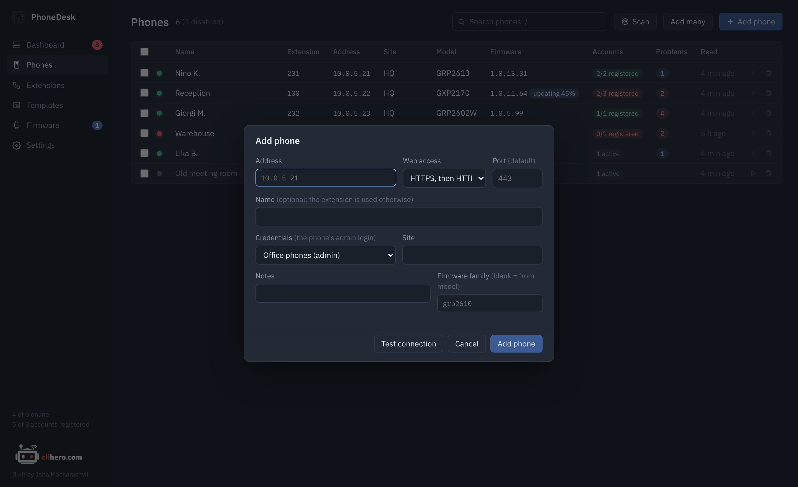
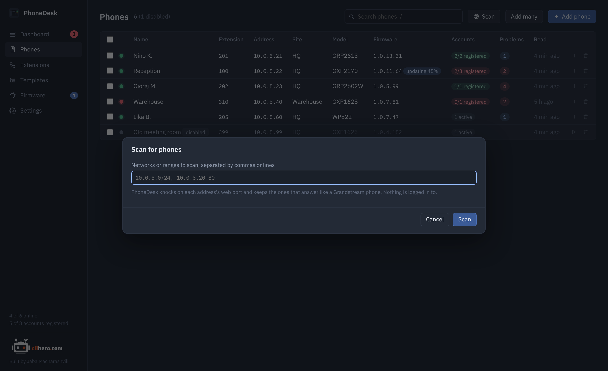
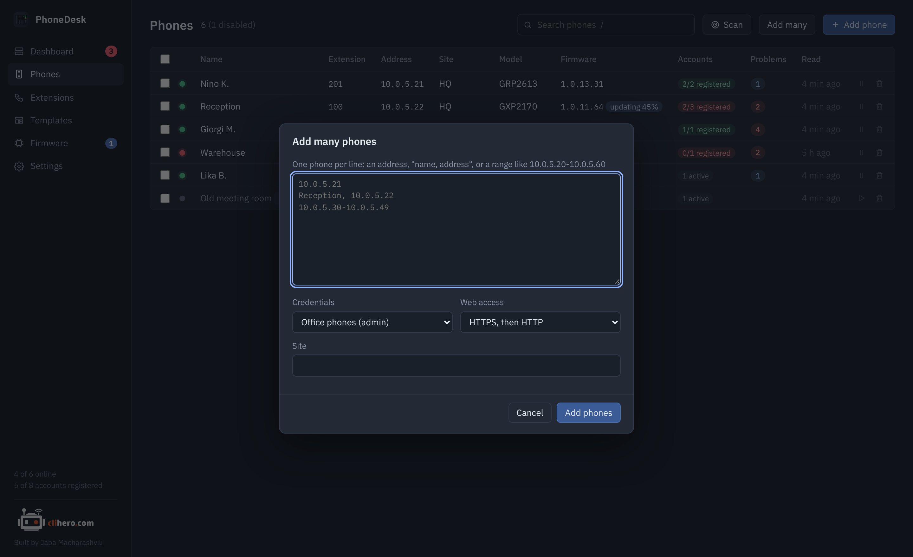

# First steps

## Add a phone

Click **Add phone** and enter the phone's address. Choose or create credentials: the phone's web login, usually `admin` and whatever you set as the admin password. Leave the scheme on **auto** and PhoneDesk tries HTTPS first, then HTTP.

{ .shot }

**Test connection** logs in and shows the model, firmware and MAC, so you know the login works before you save. The name is optional; without one, PhoneDesk shows the display name and extension of the first active account.

## Or find them

**Scan** takes networks like `10.0.5.0/24` and ranges like `10.0.6.20-80`, knocks on each address's web port and keeps the ones that answer like a Grandstream phone. Nothing is logged in to during a scan. Tick the phones you want, choose credentials and a site, and they're added.

{ .shot }

**Add many** takes a pasted list, one phone per line: an address, `name, address`, or a range.

{ .shot }

## What happens next

The first read starts right away. After that:

- Reachability is checked every 30 seconds by opening the phone's web port.
- Each phone is re-read every 15 minutes, four at a time.
- A copy of the phone's settings is saved whenever they change.

All of this is adjustable in [Settings](settings.md).

## Registration state

Whether an account is registered comes from the phone's live line status, which the phone only shares when **Action URI support** is turned on in its web UI (Settings → Remote control on GRP phones; older GXP models have it under Settings too). Until then the accounts show as "unknown" and the dashboard can't tell you about a dropped registration. Everything else works without it.

## Next

- [Dashboard and problems](dashboard.md): what the checks mean.
- [Templates and provisioning](templates.md): set NTP, time zone, syslog and the rest on every phone at once.
- [Firmware updates](firmware.md): fill the library and update.
