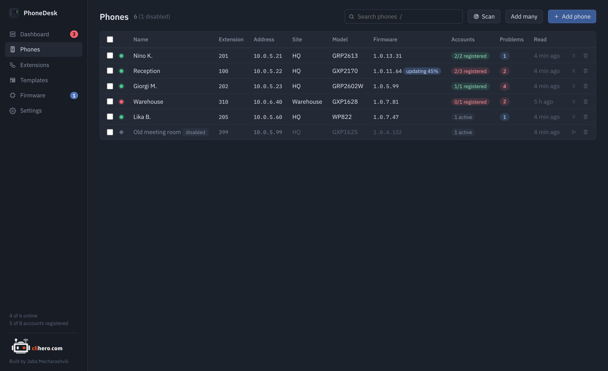
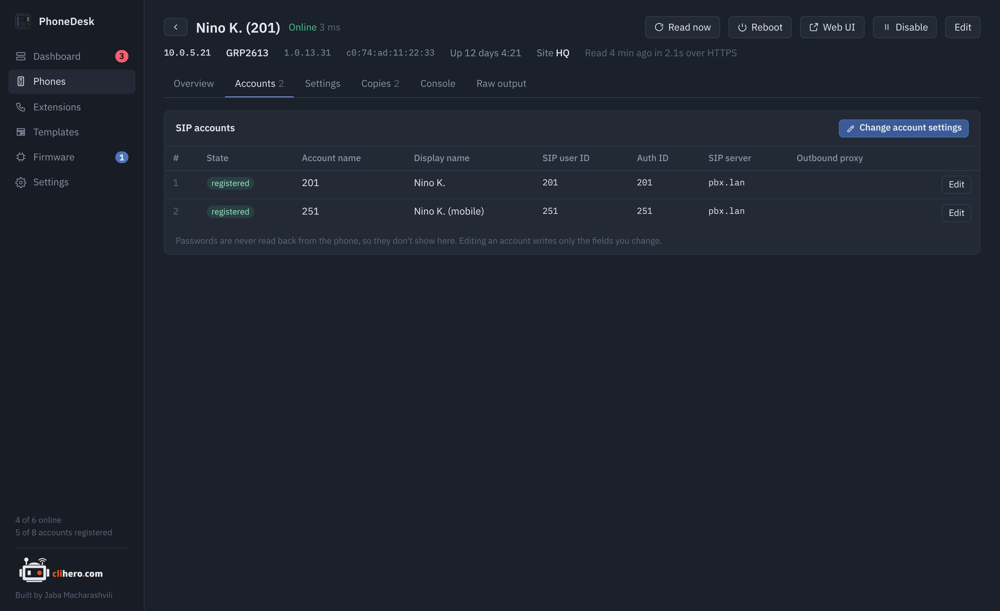
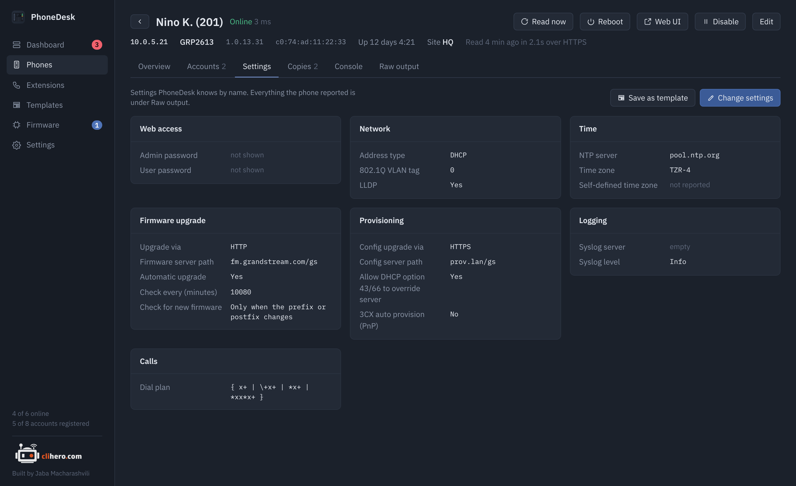
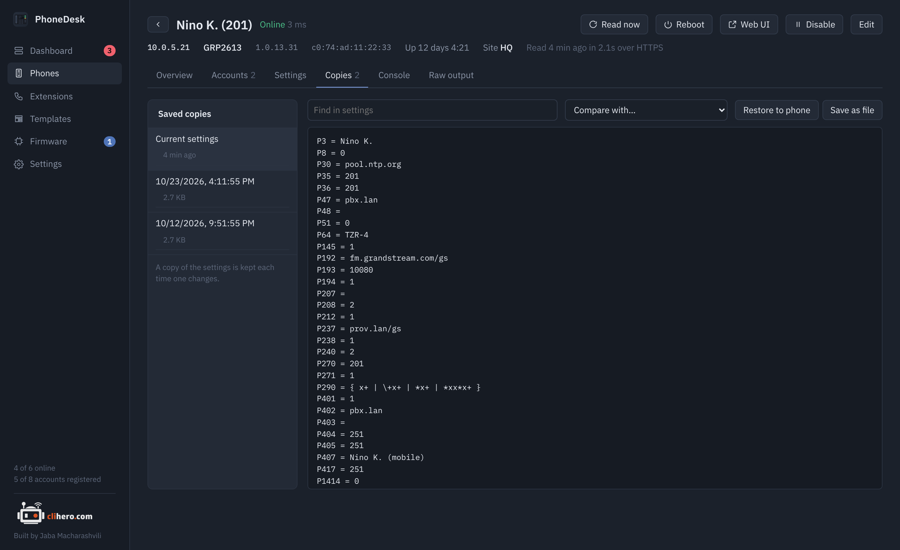
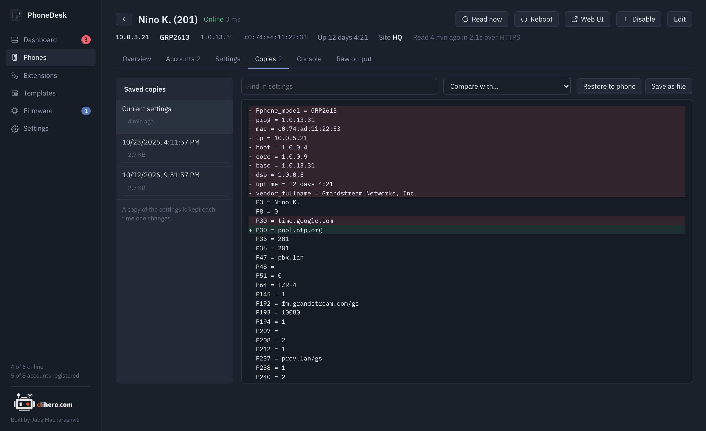
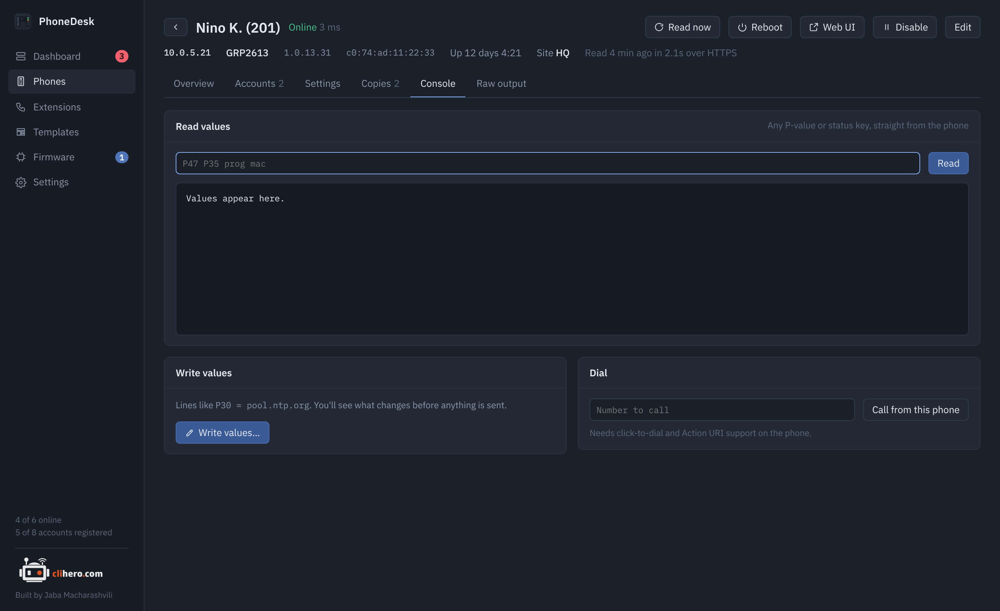

# Phones

## The list

{ .shot }

Every phone with its extensions, address, site, model, firmware, account state, problems and when it was last read. Press ++slash++ to jump to the search box. Search matches name, extension, address, site, model, firmware and MAC, and a few state words: `offline`, `disabled`, `unregistered`, `problem`, `update`. Words combine, so `hq offline` finds offline phones at the HQ site.

Tick phones and a bar appears with actions for all of them: read now, apply a template, update firmware, reboot, disable, enable, delete. The small buttons at the end of each row do the same for one phone.

A **disabled** phone keeps its last data but isn't checked, read or alerted on until you enable it again. Use it for a spare in a drawer.

## The phone page

{ .shot }

The header has the address, model, firmware, MAC, uptime and site, plus **Read now**, **Reboot**, **Web UI** (opens the phone's own web page in your browser), **Disable** and **Edit**. Below it the account LEDs, then tabs.

### Overview

Problems on this phone, system facts (model, every firmware component, MAC, IP, hardware version, part number, uptime, address type, LLDP), accounts with their registration state, firmware (running version, family, and whether your library has something newer), a management access checklist, and the live state of each line key.

The checklist reports what PhoneDesk itself saw: whether the admin password is still the default, whether it reached the phone over HTTPS or HTTP, what TCP 80, 443, 22 and 23 answer, and the time and syslog settings.

### Accounts

{ .shot }

Each SIP account with its name, display name, user ID, authenticate ID, SIP server, outbound proxy and state. **Change account settings** opens the values editor pre-filled with that account's P-values, so you can fix a server address or user ID right there.

### Settings

{ .shot }

The phone's current values grouped by topic, each with its name next to the P-value: web access, network, time, logging, provisioning, firmware upgrade, calls. **Save as template** turns the current values into a new template, which is the quickest way to make a "golden" phone the standard for the rest.

### Copies

{ .shot }

A copy of the phone's settings is saved every time they change (20 are kept by default). Pick any copy to view it, search inside it, or compare it with another: added lines green, removed lines red.

{ .shot }

**Restore to phone** writes a copy back to the phone, after a review of what would change. **Save as file** exports the copy as `P-value = value` lines.

### Console

{ .shot }

Read any P-value or status key straight from the phone, for example `P47 P35 prog mac`. Write values as `P30 = pool.ntp.org` lines; they go through the same review as a template. Dial a number from the phone, which needs click-to-dial and Action URI support turned on there.

### Raw output

Every answer the phone gave during the last read, request by request, as it came. If a value on the other tabs looks wrong, this is where to look, and what to post when asking for help.
