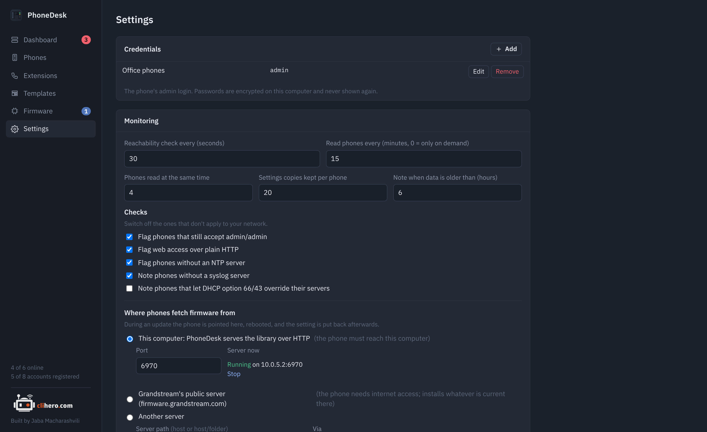

# Settings

{ .shot }

## Credentials

The phones' web logins. One set can be shared by any number of phones, which is the usual case when every phone has the same admin password. Passwords are encrypted on disk and never shown again; leave the field empty when editing to keep the old one. A credential that's still used by a phone can't be removed.

## Monitoring

| Setting | Default | Notes |
|---|---|---|
| Reachability check every | 30 s | Opens the phone's web port. |
| Read phones every | 15 min | A full read of every online phone. 0 means only when you ask. |
| Phones read at the same time | 4 | Up to 16. |
| Settings copies kept per phone | 20 | Older copies are deleted. |
| Note when data is older than | 6 h | Raises a note on the dashboard. |

## Checks

The dashboard checks that depend on how your network is set up can be switched off here: the factory password, plain HTTP web access, missing NTP, missing syslog, and DHCP option 66/43 (off by default, since many networks use it on purpose). The other checks always run.

## Where phones fetch firmware from

See [Firmware updates](firmware.md). This is also where the built-in server can be started and stopped by hand, and where its port is set.

## Data

The data folder, export and import. See [Your data](data.md).

## About

The version, links to the docs and the repository, and **Check for updates**.
