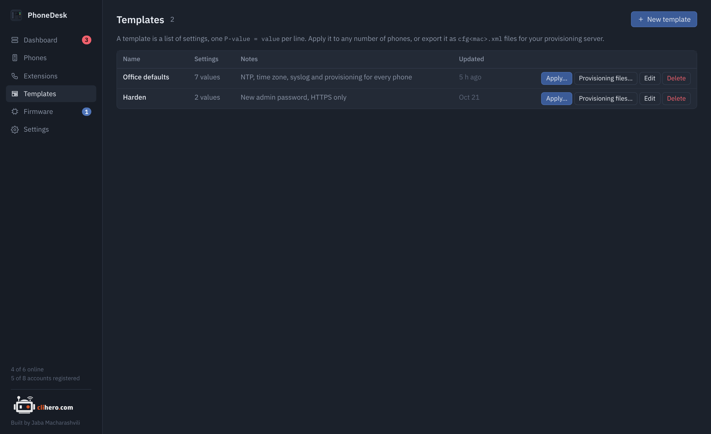
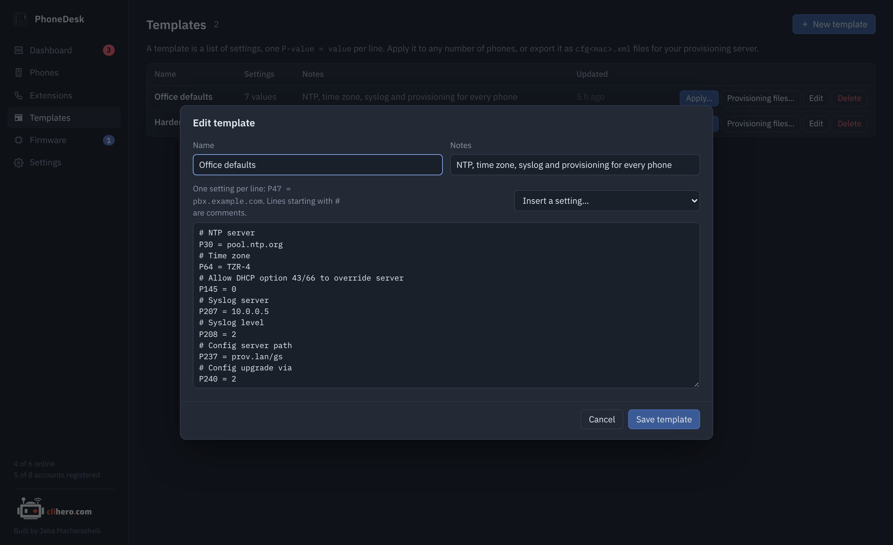
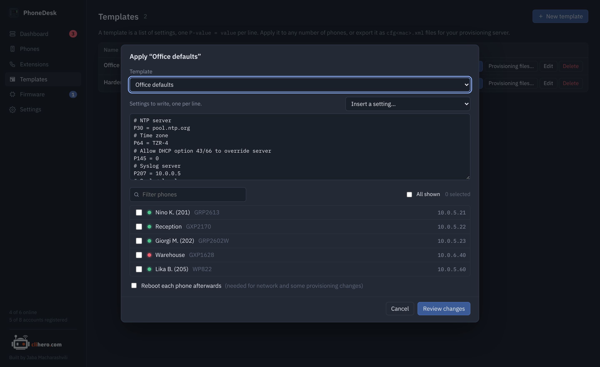
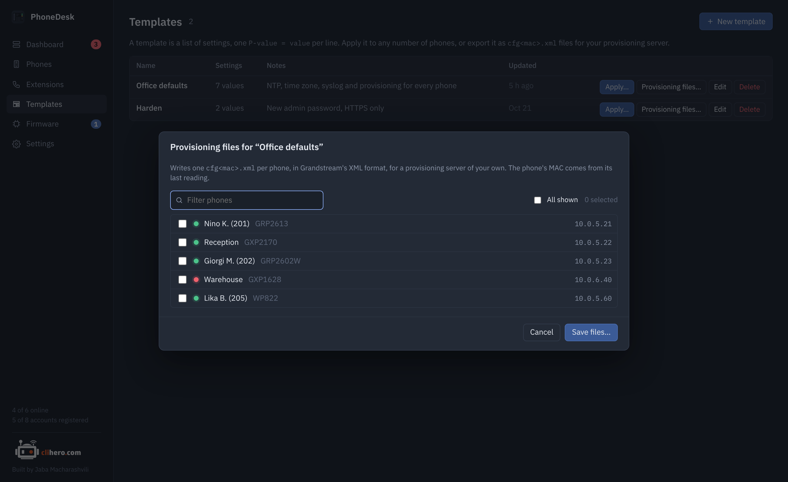

# Templates and provisioning

A template is a list of settings, one `P-value = value` per line, with a name and a note. Grandstream phones are configured entirely through these P-values, whether you set them on the web page, in a provisioning file or through PhoneDesk, so a template can hold anything the phone has a setting for.

{ .shot }

## Writing one

{ .shot }

Type lines, or pick settings by name from **Insert a setting**, which knows the common ones: the SIP accounts, the admin and user passwords, network (address type, VLAN tag, LLDP), time (NTP server, time zone), logging, provisioning and firmware servers, and a few call settings. Anything else goes in by number, straight from Grandstream's P-value guide for your model.

```
# NTP server
P30 = pool.ntp.org
# Time zone
P64 = TZR-4
# Syslog server
P207 = 10.0.0.5
P208 = 2
```

`P47 = …`, `P47=…` and `P47: …` all work. Lines starting with `#` are comments. An empty value clears the setting on the phone.

The quickest way to a template is a phone that's already set up the way you like: open it, go to **Settings** and click **Save as template**. Then delete the lines that are specific to that phone, such as its accounts.

## Applying it

**Apply** on a template, or **Apply template** from the phone list with some phones ticked, opens the same dialog: the template's lines (editable for this run), a phone picker with a filter, and a box to reboot the phones afterwards.

{ .shot }

**Review changes** reads every chosen phone first and shows, phone by phone, which values would change from what to what. Phones that already have every value are listed as unchanged. Nothing is written until you click **Apply** on that screen.

Values are written through the phone's web API and take effect right away for most settings. Accounts re-register on their own. Network settings (address type, VLAN) and some provisioning settings need a reboot, so tick the box for those.

!!! warning "Changing the admin password"
    `P2` sets the admin password, which is also the password PhoneDesk logs in with. After applying it, update the credentials under Settings so the next read still works.

## Provisioning files

**Provisioning files** on a template writes one `cfg<mac>.xml` per phone, in Grandstream's XML format, for a provisioning server you already run. The MAC comes from the phone's last reading, so phones that have never been read are skipped and named in the message. One phone saves as one file; several save as a zip.

{ .shot }

This is handy when you'd rather have the phones pull their config on every boot than have PhoneDesk push it, or when phones live where PhoneDesk can't reach them.
